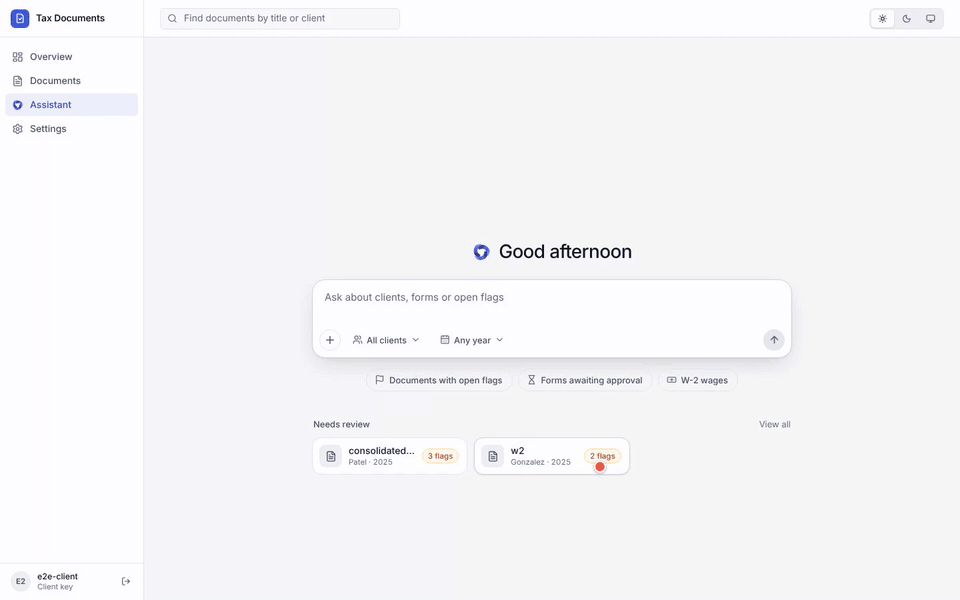

# Tax Document Assistant

FastAPI service that classifies and extracts 15 US tax form types from digital PDFs and scanned documents into typed JSON with structured review flags. A document library backs a review dashboard (each value checked side by side against where it was read on the page) and an AI assistant with read-only tools over the stored documents. Models run locally on Ollama by default.



Output requires human review against the source document. See [DISCLAIMER.md](DISCLAIMER.md) and [THIRD_PARTY_LICENSES.md](THIRD_PARTY_LICENSES.md).

> **v2 breaking change.** `validation.warnings` (strings) is replaced by `validation.flags` (`{field, code, message}` objects), and the assistant response's `searches` count by `tool_calls`. A library database created before v2 is refused with `500 outdated_library`: delete `data/library.db` and add the documents again.

## Features

- Single-form, bulk (multi-file, multi-form) and classify-only routes; PDF, PNG, JPEG, TIFF, BMP, WEBP detected from file bytes.
- Docling layout/OCR, classification by the `tev1` model or by printed headings, field mapping by an Ollama LLM.
- Amounts and TINs verified against their printed labels and positions; every kept value carries its source box.
- Document library: original files, extracted forms, per-field review decisions, hybrid (embedding + keyword) search.
- Review dashboard (`web/`): page viewer with source boxes, confirm / correct / reject, approval, assistant with citations.
- Assistant over the library via OpenAI-compatible or Anthropic chat APIs; local `qwen3.5:4b` + `nomic-embed-text` by default.
- API-key auth (client / admin), per-key rate limits, job gate, request IDs, uniform error envelope.
- Optional n8n intake and review workflow.

## Setup

### Prerequisites

| Requirement | Version / notes |
|---|---|
| Python | 3.12+ (`requires-python = ">=3.12"`) |
| [uv](https://docs.astral.sh/uv/) | Dependency and run tool (`uv.lock`) |
| Node.js | 20.19+ or 22.12+ (required by Vite 7); dashboard only |
| [Ollama](https://ollama.com) | Running server, reachable at `OLLAMA_URL` |

Ollama models:

```sh
ollama pull qwen3.5:4b         # field extraction and assistant chat (required)
ollama pull nomic-embed-text   # library search embeddings
ollama pull tev1               # classifier (optional; uses Ollama's systemone API)
```

Without `tev1`, set `TEV_MODEL=none` in `.env`: forms are identified by printed headings only (missing or unreadable headings produce `unknown`). The extraction LLM is still required.

### Backend

From the repository root:

```sh
uv sync --locked
cp .env.example .env                    # PowerShell: Copy-Item .env.example .env
uv run main.py create-key --name admin --admin
uv run main.py create-key --name client
uv run main.py serve --host 127.0.0.1 --port 8000
```

Each key is printed once; store it. Client keys call document, library and assistant routes; admin keys also manage keys and see every key's documents. `create-key --days N` sets an expiry. Docling loads its models at startup and may download weights on first run.

### Frontend

```sh
cd web
npm install
npm run dev      # http://localhost:5173; API paths proxied to http://127.0.0.1:8000 (override with API_URL)
npm run build    # web/dist, served by the API at /
```

The API mounts `web/dist` only if `web/dist/index.html` exists at startup: restart the API after the first build. Without a build, `/` redirects to `/docs`.

## Usage

- Dashboard: open `http://localhost:8000/` (built) or `http://localhost:5173/` (dev) and sign in with the client key.
- API docs: `http://localhost:8000/docs` (Swagger), `/redoc`, `/openapi.json`. In Swagger, clear unused optional fields containing the placeholder `string`.
- Health: `GET /health` returns 200 even when `data.status` is `degraded`; read the body.

In Windows PowerShell, call `curl.exe` (plain `curl` may be an alias of `Invoke-WebRequest`). Multipart examples are identical in both shells; JSON-body examples below use bash quoting (in PowerShell, put the body in a file and pass `-d "@body.json"`).

```sh
curl -H "X-API-Key: YOUR_CLIENT_KEY" -F "file=@tests/samples/w2.pdf" http://localhost:8000/v1/documents/extract
curl -H "X-API-Key: YOUR_CLIENT_KEY" -F "file=@tests/samples/w2.pdf" -F "client=Gonzalez" -F "tax_year=2025" http://localhost:8000/v1/library/documents
```

## API reference

### Conventions

- Auth: `X-API-Key` header on every route except `GET /health` (and the first `POST /api-keys` when `ALLOW_KEY_BOOTSTRAP=true` and no keys exist).
- Success: `{"data": ...}`. Error: `{"error": {"code", "message", "request_id", "details"}}`.
- `X-Request-ID` is returned on every response; a caller-supplied value is reused.
- Library, review and assistant routes are owner-scoped: a key sees only documents it added (admin: all). Another key's document is `404`.

### Routes

| Route | Auth | Purpose |
|---|---|---|
| `POST /v1/documents/extract` | Client | Extract one form from one file (`file`; `?document_type=` skips splitting and classification) |
| `POST /v1/documents/extract/bulk` | Client | Extract every form from one or more files (`files`, repeated) |
| `POST /v1/documents/classify` | Client | Classify exactly one of `file` or `text` |
| `GET /v1/document-types` | Client | Supported forms: `id`, `name` (`W-2`), `title`, field schema |
| `POST /v1/library/documents` | Client | Store a document: original file, forms, search chunks |
| `GET /v1/library/documents` | Client | List documents (filters, review counts) |
| `GET` / `DELETE /v1/library/documents/{id}` | Client | Read (pages, forms) / delete one document |
| `GET /v1/library/documents/{id}/pages/{n}` | Client | One page as PNG (`?width=`) |
| `GET /v1/library/documents/{id}/file` | Client | Original bytes (`Content-Disposition: attachment`) |
| `GET /v1/library/stats` | Client | Dashboard counts (list filters) |
| `POST /v1/library/search` | Client | Hybrid search |
| `GET /v1/library/forms/{form_id}` | Client | A form as review checks |
| `PUT` / `DELETE /v1/library/forms/{form_id}/reviews/{field}` | Client | Set / clear the decision on one field |
| `POST /v1/library/forms/{form_id}/approve` | Client | Approve a form |
| `POST /v1/library/forms/{form_id}/reopen` | Client | Set a form back to `pending` |
| `POST /v1/assistant/chat` | Client | Ask the assistant about library documents |
| `GET /health` | None | Parser and model readiness: `status` (`ok` / `degraded`), `docling_loaded`, `ollama_reachable`, `models` |
| `GET /auth/me` | Client | The current key |
| `POST` / `GET /api-keys` | Admin | Create (`name`, `is_admin`, `expires_in_days`) / list keys |
| `DELETE /api-keys/{id}` | Admin | Revoke a key |

"Client" means any valid key (client or admin).

### Extraction

`POST /v1/documents/extract` returns in `data`: `document_type`, `form_name`, `classification`, `fields`, `validation`, `document`, `extraction_model`, `timings_ms`.

- `fields` follows the schema from `GET /v1/document-types`: amounts are numbers, dates normalized, checkboxes booleans or `null`; missing scalars are generally `null`, repeated fields are arrays.
- `validation`: `flags`, field counts, `sources`; `valid` is true when there are no flags. A valid schema does not prove accuracy or completeness.
- `document.conversion` is `partial` when Docling reported errors (`conversion_errors`); `document.missing_pages` lists pages with no text.
- A multi-form file returns `422 multiple_forms` (use bulk); an unidentified form `422 unsupported_document_type`; a file with no readable text `422 unreadable_document`.

`POST /v1/documents/extract/bulk` returns `data.files`, `data.summary`, `data.timings_ms`. Each file has metadata, `document`, and `forms[]` with source pages and a status:

| Form status | Meaning |
|---|---|
| `ok` | Identified and extracted; inspect `validation.flags` |
| `unsupported` | Not identified as a supported form; `fields` is `null` |
| `duplicate` | Same type and every extracted value identical to an earlier form in the file (`duplicate_of`); forms with no TIN and no amount are never duplicates |

A file that fails to parse is `status: failed` with `error`; other files continue. Upload validation and model backend errors fail the whole request. `summary.forms` and `summary.by_type` count `ok` forms only. Processing is synchronous and sequential: large statements can take minutes, so set client timeouts or send one file per request.

`POST /v1/documents/classify` returns one classification from the configured classifier. Digital PDFs use embedded text from the first two pages when available; scans go through OCR. `document` can be `null` (text input or the embedded-text path).

### Flags

Each flag is `{field, code, message}`. `field` is a path in `sources` syntax (`employee.tin`, `box12[0].amount`) or `null` for the whole form; `message` never contains a full TIN. Codes are defined in [core/flags.py](core/flags.py) (`Flag.code` in the OpenAPI schema).

| `code` | Meaning |
|---|---|
| `not_printed` | Value removed: not printed in the document |
| `wrong_label` | Value removed: printed only under another field's label |
| `unlabeled` | Value kept, but not found in its labeled box |
| `unparseable` | Value dropped: not a valid amount, date, TIN, ... |
| `multiple_values` | Several printed values in one box; the first was kept |
| `text_as_json` | The model returned JSON for a text field; flattened |
| `no_output` | No usable JSON from the extraction model (form-level) |
| `inconsistent` | Amounts don't add up (e.g. W-2 box 4 vs 6.2% of box 3); on the field that looks off |
| `partial_conversion` | File only partly converted (form-level) |
| `missing_page` | A page in the form's range produced no text (form-level) |
| `uncertain_type` | Identified by printed heading; classifier not confident (form-level) |

### Grounding and sources

With `STRICT_GROUNDING=true` ([core/grounding.py](core/grounding.py), run by `LLMExtractor.extract`):

- Amounts and TINs must sit in the box of their own label. Not printed at all (zero included: a blank box is not `0.00`) → removed, `not_printed`. Printed only under another label → removed, `wrong_label`. Printed but not in a labeled box, or label not found → kept, `unlabeled`.
- Other values (names, addresses, codes, dates, years, checkboxes) are only located, never removed or flagged.
- `validation.sources` maps each kept amount/TIN, located value and table row (`transactions[3]`) to `{label, page, box}`; `box` is left, top, right, bottom on a page 1000 units wide, origin top-left. Values not found have no entry.

### Library

`POST /v1/library/documents` (multipart): `file`, optional `client`, `tax_year`, `title`, `location`, `extract` (default `true`). Returns `201`, or `200` with the stored document when the same file was already added by this key.

- Accepted: PDF and images (form extraction, as bulk; up to `BULK_MAX_PAGES` pages), `.txt`, `.md`, `.csv`, `.xlsx` (no forms). `extract=false` stores page text only (no LLM).
- Forms are stored with status, pages, classification, fields and validation; `ok` forms start `review_status: pending`.
- Search chunks: each `ok` form as `path: value` lines with form ID and tax year, plus text of pages without a form. Text files split by Markdown heading, CSV/sheet rows (header repeated) or paragraphs, at most `library.chunk_chars` each.
- SSNs are masked to the last four digits in every chunk before storage or embedding. Stored form fields keep values as extracted.
- Originals are stored under `library.files` (default `data/files/`) named by SHA-256, shared across keys, removed with the last document using them.

| Route | Contract |
|---|---|
| `GET /v1/library/documents` | Query: `client`, `tax_year`, `document_type` (form ID or `text`), `review_status` (`pending`: a form awaits approval; `approved`: every `ok` form approved), `q` (title or client substring), `limit` (1–200, default 50), `offset`, `order` (`newest` / `oldest`). `data: {count, documents[]}`; each: `id, title, type, media_type, length_bytes, location, content_hash, client, tax_year, created_at, chunks, document_types, page_count, review_status` (`null` without forms), `forms_pending, forms_approved, open_flags` |
| `GET /v1/library/documents/{id}` | Document plus `pages: [{n, width, height}]` (PDF points or image pixels) and `forms: [{id, index, status, pages, document_type, form_name, duplicate_of, review_status, open_flags}]` |
| `GET /v1/library/documents/{id}/pages/{n}` | `image/png`; `width` 100–2400 (default 1200). `ETag: "<sha256>-<n>-<width>"` (`If-None-Match` → 304), `Cache-Control: private, max-age=86400`. Map a source `box` onto the image by multiplying by `width / 1000` |
| `GET /v1/library/stats` | List filters. `data: {documents, forms` (`ok`), `forms_by_type, forms_by_review_status: {pending, approved}, open_flags, clients: [{client, documents, forms_pending, open_flags}]}` |
| `POST /v1/library/search` | Body `{query, filters: {client, tax_year, document_type, document_ids}, limit}`; `limit` default `library.default_results`, max `library.max_results` |

`open_flags` counts flagged fields without a review decision.

Search: filters are applied in SQLite first; remaining chunks are ranked by exact cosine similarity (batched) and by SQLite FTS5 keywords, then merged by reciprocal rank fusion ([library/search.py](library/search.py)). Each hit's `similarity` is the cosine value, `null` for keyword-only matches.

### Review

```sh
curl -H "X-API-Key: YOUR_CLIENT_KEY" http://localhost:8000/v1/library/forms/FORM_ID
curl -X PUT -H "X-API-Key: YOUR_CLIENT_KEY" -H "Content-Type: application/json" -d '{"decision": "corrected", "value": "68,412.55"}' http://localhost:8000/v1/library/forms/FORM_ID/reviews/wages_tips_other_comp
curl -X POST -H "X-API-Key: YOUR_CLIENT_KEY" http://localhost:8000/v1/library/forms/FORM_ID/approve
```

`GET /v1/library/forms/{form_id}`: form summary plus `document_id, classification, text_layer, extraction_model, approved_by, approved_at`, and

- `checks[]`: every scalar schema field in schema order (empty ones included); list fields contribute extracted rows only. Each: `field`, `label`, `group`, `kind` (`money, percent, tin, date, check, state, year, month, acquired, choice, text`), `options` (`choice`), `value`, `source` (`{label, page, box}` or `null`), `flags`, `review` (`{decision, value, note, reviewer, reviewer_id, updated_at}` or `null`).
- `flags`: form-level flags. `checked`, `total`, `open_flags`. `corrected_fields`: fields with every decision applied (`null` for unsupported forms).

Rules ([library/review.py](library/review.py), [library/service.py](library/service.py)):

- `PUT .../reviews/{field}` body `{decision, value?, note?}`: `confirmed`; `corrected` (`value` required, parsed like extracted values, else `422 invalid_value`); `rejected` (`null` in `corrected_fields`). Returns the check; records the key's id and name. `DELETE` clears it. Unknown field → `404`; unsupported/duplicate form → `409 not_reviewable`.
- `POST .../approve` requires a decision on every flagged field, else `409 review_incomplete` with `details.undecided`. `reopen`, or any `PUT`/`DELETE` on an approved form, sets it back to `pending`.
- A decision that changes values rebuilds the form's search chunks from `corrected_fields` in the same transaction.

### Assistant

```sh
curl -H "X-API-Key: YOUR_CLIENT_KEY" -H "Content-Type: application/json" -d '{"messages": [{"role": "user", "content": "What were the 2025 wages?"}], "scope": {"client": "Gonzalez"}}' http://localhost:8000/v1/assistant/chat
```

Stateless: send the conversation so far, ending with the user's message. `scope` (`client`, `tax_year`, `document_type`, `document_ids`) bounds every tool; the model can narrow it, not widen it. Up to `assistant.max_tool_rounds` tool rounds, then the model must answer, citing excerpts as `[n]`. Response `data`: `message`, `sources` (every retrieved excerpt, numbered as cited), `tool_calls` (`[{name, arguments}]`), `model`, `usage`.

Tools ([agent/tools.py](agent/tools.py)), all read-only; errors return to the model as `error: ...` text:

| Tool | Arguments | Returns |
|---|---|---|
| `search_documents` | `query`, `client`, `tax_year`, `document_type`, `limit` | Numbered excerpts with document ID, client, form, year, page |
| `list_documents` | `client`, `tax_year`, `document_type`, `review_status`, `limit` | One line per document with review counts and open flags |
| `get_document` | `document_id` | Metadata, forms with review status and open flags, reviewed values (SSNs masked) |
| `classify_document` | `document_id`, `pages` | Classifier result on the stored file (`pages`: PDF subset) |
| `extract_document` | `document_id`, `document_type` | Fields and flags, not saved; holds an extraction slot (`MAX_CONCURRENT_JOBS`) |

### Error codes

| HTTP | `error.code` |
|---|---|
| 400 | `bad_request` |
| 401 / 403 | `unauthorized` / `forbidden` |
| 404 | `not_found` |
| 409 | `index_mismatch` (library built with another embedding model); `review_incomplete` (`details.undecided`); `not_reviewable` |
| 413 | `payload_too_large`, `too_many_pages` |
| 415 | `unsupported_media_type` (`details.supported`) |
| 422 | `unreadable_document`, `unsupported_document_type`, `multiple_forms` (`details.forms`), `invalid_request` (`details.errors`), `invalid_value` (`details.field`) |
| 429 | `rate_limited` (`Retry-After`) |
| 500 | `internal_error`; `outdated_library` (pre-v2 library database) |
| 503 | `model_unavailable` (`Retry-After: 10`; unreachable or rejecting provider); `busy` (all job slots and queue taken, `Retry-After: 30`) |

### Supported forms

Form IDs are used by `document_type`; definitions in [core/forms.py](core/forms.py).

| ID | Form | Main data |
|---|---|---|
| `w2` | W-2 | Wages, withholding, coded boxes, state/local rows |
| `1099_nec` | 1099-NEC | Nonemployee compensation |
| `1099_misc` | 1099-MISC | Rents, royalties, other income |
| `1099_int` | 1099-INT | Interest income and related amounts |
| `1099_div` | 1099-DIV | Dividends and capital gain distributions |
| `1099_b` | 1099-B | Sales, proceeds, basis, wash sales, transaction categories |
| `1099_r` | 1099-R | Retirement distributions and distribution codes |
| `1099_g` | 1099-G | Government payments |
| `1099_k` | 1099-K | Payment transactions and monthly amounts |
| `ssa_1099` | SSA-1099 | Social Security benefits |
| `1098` | 1098 | Mortgage interest and loan details |
| `1098_t` | 1098-T | Tuition, scholarships, student status |
| `1098_e` | 1098-E | Student loan interest |
| `1095_a` | 1095-A | Coverage, covered individuals, monthly and annual amounts |
| `k1_1065` | Schedule K-1 (Form 1065) | Partnership income, coded items, capital account |

## Configuration

Settings come from environment variables and the repository-root `.env` ([.env.example](.env.example)); [core/config.py](core/config.py) is the complete model.

### Models and parsing

| Variable | Default | Purpose |
|---|---|---|
| `OLLAMA_URL` | `http://localhost:11434` | Model server URL (not Ollama's server-side `OLLAMA_HOST`) |
| `OLLAMA_TIMEOUT_S` / `OLLAMA_KEEP_ALIVE` | `180` / `30m` | Request timeout / model residency |
| `TEV_MODEL` | `tev1` | Classifier; `none` = heading-only |
| `TEV_MIN_CONFIDENCE` / `TEV_MAX_STATE_CHARS` | `0.5` / `3000` | Classifier acceptance threshold / input limit |
| `EXTRACTOR_MODEL` / `EXTRACTOR_NUM_CTX` | `qwen3.5:4b` / `8192` | Extraction model / context tokens |
| `EXTRACTOR_OUTPUT_TOKENS` | `2048` | Answer budget (`num_predict`); evidence gets the rest |
| `STRICT_GROUNDING` | `true` | Verify amounts and TINs against labels/positions; record `validation.sources` |
| `DOCLING_DEVICE` / `DOCLING_THREADS` | `auto` / `4` | `auto`, `cpu`, `cuda`, `mps` / CPU threads |
| `DOCLING_MAX_CONCURRENCY` | `1` | Concurrent conversions per process |
| `DOCLING_TIMEOUT_S` | `120` | Conversion timeout (s) |
| `DOCLING_TABLES` | `false` | TableFormer (the pipeline has its own table reader) |
| `DOCLING_WARMUP` | `true` | Small conversion at startup |
| `DOCLING_ARTIFACTS_PATH` | unset | Local Docling weights directory |

Offline Docling weights: `uv run main.py download-models --to models/docling`, then `DOCLING_ARTIFACTS_PATH=models/docling`.

### API and limits

| Variable | Default | Purpose |
|---|---|---|
| `APP_NAME` | `Tax Document API` | API title |
| `DATABASE_URL` | `sqlite:///<project-root>/tax_document_database.db` | API-key database |
| `ALLOW_KEY_BOOTSTRAP` | `false` | Allow unauthenticated creation of the first (admin) key |
| `LOG_LEVEL` / `LOG_JSON` | `INFO` / `true` | Log level / JSON logs |
| `MAX_UPLOAD_MB` / `MAX_PAGES` | `20` / `10` | Per-file upload limit / single-form route page limit |
| `BULK_MAX_FILES` / `BULK_MAX_PAGES` | `20` / `100` | Files per bulk request / pages per file |
| `BULK_MAX_TOTAL_MB` | `100` | Bulk body limit, counted as bytes arrive |
| `MAX_CONCURRENT_JOBS` / `MAX_QUEUED_JOBS` | `2` / `8` | Extract, bulk and library-upload jobs running / waiting; beyond → `503 busy` |
| `ASSISTANT_CONFIG` | `config/model_config.yml` | Assistant, embedding and library settings |

Rate limits (requests per key per window; window variable `*_RATE_SECONDS`, default `60`):

| Calls variable | Default | Routes |
|---|---|---|
| `PIPELINE_RATE_CALLS` | `30` | `extract` |
| `BULK_RATE_CALLS` | `10` | `extract/bulk` |
| `CLASSIFY_RATE_CALLS` | `120` | `classify` |
| `LIBRARY_RATE_CALLS` | `30` | Library uploads |
| `SEARCH_RATE_CALLS` | `120` | Library search |
| `ASSISTANT_RATE_CALLS` | `30` | Assistant chat |

### model_config.yml

[config/model_config.yml](config/model_config.yml) configures `chat`, `embeddings`, `library` and `assistant`. Providers: `ollama`, `openai`, `openrouter` (OpenAI-compatible API) and `anthropic` (Messages API, chat only), called over plain HTTP. Cloud API keys are read from the environment variable named by `api_key_env`, never from the file.

| Key | Default | Notes |
|---|---|---|
| `chat.model` | `qwen3.5:4b` (ollama) | `options` is merged into each request body; `max_completion_tokens` there replaces `max_tokens` |
| `embeddings.model` | `nomic-embed-text` (ollama) | Changing model or `dimensions` → `409 index_mismatch`: delete the library database (or set a new `library.database`) and re-add documents |
| `embeddings.query_prefix` / `document_prefix` | `"search_query: "` / `"search_document: "` | Set both to `""` for models without task prefixes |
| `library.database` / `library.files` | `data/library.db` / `data/files` | Relative to the project root |
| `library.chunk_chars` | `1500` | Max characters per chunk |
| `library.default_results` / `max_results` | `8` / `20` | Search result count |
| `assistant.max_tool_rounds` | `4` | Tool rounds before the model must answer |

Ollama's OpenAI-compatible API cannot set context size per request; if answers or excerpts are cut off, start Ollama with a larger `OLLAMA_CONTEXT_LENGTH` (e.g. `8192`).

## Development and testing

```sh
uv run pytest -m "not integration"     # unit/API tests, synthetic data, no models
uv run pytest -m integration           # real Docling + Ollama; skipped when models are missing (check the skip count)
uv run python -m tests.evaluate        # accuracy report -> tests/reports/latest.json
node n8n/tests/code-nodes.test.mjs n8n/tax-document-intake.workflow.json n8n/tests/api-fixtures.json
uv run python -m scripts.licenses
```

Dashboard (in `web/`):

```sh
npm run typecheck
npm test         # Vitest unit tests
npm run e2e      # build + Playwright on tests.e2e.stack (fake models; set HF_HUB_CACHE if Docling weights are elsewhere)
```

After changing an API model or route, regenerate the dashboard types (both are checked by tests):

```sh
uv run python -m scripts.openapi       # web/src/api/openapi.json (tests/test_web.py)
cd web
npm run gen:api                        # web/src/api/schema.d.ts (npm test)
```

Full stack without GPUs or Ollama (real Docling, fake extraction/embedding/chat models, fresh data directory, keys printed as JSON):

```sh
uv run python -m tests.e2e.stack --api-port 8000 --models-port 11435
```

Accuracy on real documents: put redacted files in `tests/samples/redacted/` as `<name>.pdf` (or an image) with `<name>.forms.json`, a list of `{"document_type", "pages", "fields"}` in page order (`"status": "duplicate"` for repeated copies, `"fields": null` for non-form pages). The evaluator and `pytest -m integration` hold them to the scan accuracy bar. A field is scored when either side has a value: `0.00` against `null` is an error; `null`, `""`, `[]` and an unchecked box count as missing.

### Project layout

```text
Upload -> Docling parse/OCR -> split into forms -> classify
       -> read tables + pair labels/values -> LLM field mapping
       -> read checkboxes -> normalize and validate -> verify against labels/positions -> JSON
```

| Location | Responsibility |
|---|---|
| [main.py](main.py) | CLI: `serve`, `create-key`, `download-models`; `main:app` ASGI app |
| [api/](api/) | Routes, auth, rate limits, body limit, errors, dashboard serving ([api/web.py](api/web.py)) |
| [core/pipeline.py](core/pipeline.py) | Single-form and bulk orchestration |
| [core/parser.py](core/parser.py) | Docling lifecycle, conversion, page images |
| [core/segment.py](core/segment.py), [core/tev.py](core/tev.py) | Form boundaries, classification |
| [core/layout.py](core/layout.py), [core/tables.py](core/tables.py), [core/checkboxes.py](core/checkboxes.py) | Label/value pairing, table rows, checkboxes |
| [core/extractor.py](core/extractor.py) | Evidence chunks within the token budget, LLM mapping, answer merging |
| [core/grounding.py](core/grounding.py) | Amount/TIN verification, value sources |
| [core/flags.py](core/flags.py) | `Flag` and flag codes |
| [core/jobs.py](core/jobs.py) | Extraction job gate |
| [core/forms.py](core/forms.py), [core/schema.py](core/schema.py), [core/utils.py](core/utils.py) | Form definitions, response models, normalization |
| [core/auth.py](core/auth.py), [core/db.py](core/db.py), [core/models.py](core/models.py) | API-key storage |
| [library/](library/) | SQLite store, ingestion, hybrid search, files and page rendering, review rules |
| [agent/](agent/) | Assistant config, provider wire formats, tool loop, tools |
| [web/](web/) | React dashboard |
| [scripts/](scripts/) | OpenAPI export, license listing |
| [tests/](tests/) | Unit/API, integration, evaluator, fixtures, fake model server, E2E stack |
| [n8n/](n8n/) | Optional intake and review workflow |

Dependency direction: `api -> agent -> library -> core`. Request traces, test map and recipes (routes, tools, form types, flag codes, schema changes): [docs/DEVELOPING.md](docs/DEVELOPING.md). Dashboard structure and recipes: [web/README.md](web/README.md).

## Data handling and limitations

- Extraction routes (`/v1/documents/...`) store nothing; multipart handling may spool large uploads to temporary disk. Document evidence is sent to the configured Ollama server.
- The key database stores key hashes and metadata only.
- The library stores originals (`data/files/`) and, in `data/library.db`, forms with fields as read (full TINs), review decisions (reviewer key name, time), and chunks/embeddings (SSNs masked; names, addresses, amounts, EINs as printed). Both paths are gitignored; treat them and their backups as taxpayer data. A configured cloud chat provider receives questions and tool results (SSNs masked).
- Logs contain request and processing metadata; error messages and third-party diagnostics have not been audited for a strict no-sensitive-data guarantee.
- One worker per process; each process loads its own models and keeps its own rate-limit windows. Shared deployments need a shared limit or gateway policy. Terminate TLS at a reverse proxy and set a proxy body limit.
- Each running job holds its uploads in memory (up to `BULK_MAX_TOTAL_MB`); queued jobs spool to disk. Classification is not gated.
- Splitting is heuristic; pages without text are reported in `missing_pages`. Extraction noise can leave a real duplicate marked `ok`.
- Evidence token counts are estimated (digits one token each, other characters one per three, 10% margin), not tokenized.
- Synthetic test results do not establish accuracy on client documents.
- Export to tax or practice-management software is not implemented; map `fields` using `GET /v1/document-types`.

## Optional n8n integration

[n8n/README.md](n8n/README.md) covers the importable intake workflow (uploads, email attachments, Drive files, webhooks → bulk API), credentials, review routing, the `tax_document_log` table and notifications. The log stores extracted fields with TINs masked; failed execution records may retain document data. Configure retention and access in n8n separately.

## License and disclaimer

[DISCLAIMER.md](DISCLAIMER.md) · [THIRD_PARTY_LICENSES.md](THIRD_PARTY_LICENSES.md)
